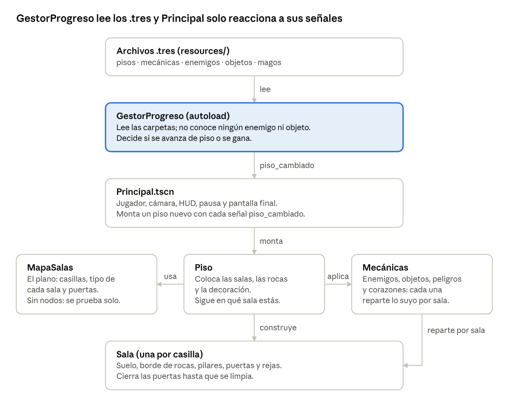

# Vacío — todo lo hecho hasta ahora

Actualizado el 8 de octubre de 2026 · Matías

## Resumen

Vacío se puede jugar de principio a fin. Son 12 pisos, 11 tipos de enemigo y 3 magos para elegir, y desde el 6 de octubre de 2026 hay un `.exe` descargable que se actualiza solo. Es un juego 2D top-down hecho en Godot 4.7 (GDScript) como proyecto de clase de 1.º de DAM, entre 3 personas. Lo empezamos el 17 de septiembre de 2026 y lleva 53 commits en GitHub.

Se baja por las capas de la Tierra, de la corteza al núcleo interno. El rumbo es parecerse a *The Binding of Isaac*:

- Cada piso es un mapa de salas unidas por puertas.
- **Una sala secreta por piso:** escondida tras una pared con unas grietas finas, que se rompe con tres disparos. Dentro, un cofre: al pisarlo sale una ruleta con las ventajas y te toca una al azar.
- **El piso 1 es un tutorial:** cinco salas en fila, y al entrar en cada una sale una ventana (con el juego parado) que explica una cosa: moverse y disparar; el ataque especial, las rocas, la vida y el mapa; matar a todos los enemigos para que se abran las puertas, con la primera pelea; los objetos; la bajada.
- Al entrar en una sala con enemigos, las puertas se cierran hasta limpiarla.
- Cada piso tiene más salas que el anterior, y más pequeñas. Todo se ve del mismo tamaño en todos los pisos: la cámara no se acerca al bajar.

**Cómo se juega ahora:**

- **Al empezar:** se elige entre el mago oscuro, el rojo y el blanco. Cada uno tiene una ventaja y una pega: la bola cargada del oscuro abre un agujero negro; los disparos del rojo queman; el blanco, en vez de ataque cargado, saca una burbuja que lo cubre entero y hace rebotar disparos y enemigos, y su disparo frena a los enemigos.
- **Moverse y disparar:** WASD para moverse. Se dispara con las flechas o con clic izquierdo, apuntando con el ratón: una bola cada medio segundo. En Controles se puede elegir moverse con las flechas (y disparar con WASD).
- **Ataque especial (clic derecho o espacio):** el mago oscuro y el rojo lo mantienen para cargar una bola, que se suelta cuando está cargada; atraviesa enemigos y quita 30 (el normal, 10). La del oscuro llega menos lejos, pero abre un agujero negro que atrae a los enemigos y les quita vida. El blanco saca una burbuja de 5 s en la que rebotan los disparos y los enemigos; un disparo rebotado quita al enemigo que toque lo mismo que quitaba al mago. El ataque especial es uno por piso. Con el clic derecho sale hacia el ratón; con el espacio, hacia donde apuntan las flechas o hacia donde mira el mago.
- **Pausa:** Escape (continuar, reiniciar o volver al menú).
- **Pantalla completa:** el juego empieza a pantalla completa; F11 (o Alt+Intro) pasa a ventana y vuelve, y se acuerda.
- **Cooperativo:** en Jugar → Cooperativo en red local, hasta 3 jugadores en la misma red, con un código de sala. La partida entera: peleas para todos, se baja juntos y el que cae vuelve en el piso siguiente con media vida.
- **Enemigos:** salen desde el piso 2, y cada uno pelea a su manera: slimes que saltan (el de magma dejando lava) o rebotan, rata en zigzag, murciélago en picado, fantasma que se desvanece, planta que excava, serpiente en abanico, planta con anillos de esporas, gólem con pisotón y cristal que se teletransporta. Todos avisan antes de lo que pega de golpe.
- **Peligros del suelo:** pinchos, agujeros al vacío y lava.
- **Recompensas:** un objeto de mejora por piso. Además, los enemigos sueltan ventajas a veces y, al limpiar una sala, a veces cae un vendaje que cura 60 (es lo único que cura).

**Dónde está:**

- **Código:** [github.com/MatiasRodrigo0502/Vacio](https://github.com/MatiasRodrigo0502/Vacio)
- **Para jugar sin Godot:** [Vacio.exe para Windows](https://github.com/MatiasRodrigo0502/Vacio/releases/latest/download/Vacio.exe), [Vacio-linux.tar.gz para Linux](https://github.com/MatiasRodrigo0502/Vacio/releases/latest/download/Vacio-linux.tar.gz) o [Vacio-mac.zip para Mac](https://github.com/MatiasRodrigo0502/Vacio/releases/latest/download/Vacio-mac.zip), última versión

## Reglas y forma de trabajar

El proyecto sigue cinco reglas, pensadas para que tres personas trabajen a la vez sin pisarse:

1. **Todo en español:** scripts, clases, variables, funciones, nodos y comentarios.
2. **Los comentarios explican el porqué**, no el qué. Si se descartó una alternativa razonable, se dice por qué.
3. **Ampliar el juego no toca código.** Los pisos, el arte, las mecánicas, los enemigos, los objetos y los magos viven en archivos `.tres`. Añadir uno es crear otro archivo.
4. **Un archivo por unidad de trabajo.**
5. **Se sube a GitHub después de cada cambio terminado.** El repositorio del instituto (`instituto`) se queda atrás a propósito y solo se sube cuando Matías lo pide.

**Cómo se comprueba cada cambio** antes de subirlo:

- Godot se ejecuta sin ventana para importar y sacar errores de los scripts.
- Una escena de prueba temporal monta la partida y mide lo que toque: nodos, distancias, píxeles. Al acabar se borra.
- Las capturas se hacen solo desde dentro del juego, nunca de la pantalla del ordenador.
- Se mide en vez de fiarse de la vista. Tres veces, la impresión visual del contraste fue la contraria a la medición.

**En git:**

- Nunca `git add -A`: se añade cada archivo por su ruta, porque puede haber trabajo de otra persona en la carpeta.
- No se reescribe el historial.

**Para el resto del equipo:** el reparto práctico es que la dificultad se ajusta en `resources/pisos/` (un piso por persona) y una mecánica nueva es un script más un `.tres` nuevos. Las escenas `.tscn` las toca una sola persona cada vez, porque Godot las reordena al guardar.

## Arquitectura

El juego se amplía añadiendo archivos `.tres`, sin tocar código. `GestorProgreso` lee las carpetas sin conocer ningún piso, enemigo ni objeto concreto, y la escena de la partida solo reacciona a sus señales.



Cada pieza vive en su propio archivo, así que tres personas pueden tocar partes distintas a la vez. Los pisos son deterministas: cada reparto usa una semilla del piso, y los 12 pisos salen iguales en los tres ordenadores. Lo único al azar son las ventajas que sueltan los enemigos.

## Cronología

En tres semanas, el juego pasó de una base con obstáculos a un *roguelite* de salas con combate. Esta tabla agrupa los 53 commits por día y tema, de lo más reciente a lo más antiguo.

| Fecha | Qué | Commits |
| --- | --- | --- |
| 29/10/2026 | Una sala secreta en cada piso, tras una pared agrietada que se rompe a disparos, con un cofre y una ruleta de ventajas | — |
| 29/10/2026 | El piso 1 es un tutorial: cinco salas en fila, una ventana que explica una cosa en cada una, y en la tercera la primera pelea | `33fc16a` |
| 29/10/2026 | Al acabar la partida, «Cambiar mago»: se empieza de cero con uno de los magos que no se han usado | `a474c6b` |
| 22/10/2026 | Los enemigos y todo lo demás se ven del mismo tamaño en todos los pisos (la cámara del piso 2) | `743bb0f` |
| 21/10/2026 | El rayo del cristal vuelve a quitar 50 y el jefe final es más difícil (1500 de vida, más rápido, rayos de 3 y de 5) | `491999b` |
| 20/10/2026 | Lo que asoma de las salas de al lado queda a oscuras | `436ea37` |
| 18/10/2026 | Cooperativo, fase 2: la partida entera en red local (enemigos del anfitrión, peleas para todos, caer y volver, bajar juntos) | `bb08de7` |
| 18/10/2026 | En Controles se elige moverse con WASD o con las flechas | `1e486e5` |
| 16/10/2026 | Cooperativo en red local, fase 1: sala con código, hasta 3 magos en el piso 1, objetos para todos | `5897722` |
| 16/10/2026 | Las escenas de prueba ya no guardan partidas en el registro | `d1cddcd` |
| 15/10/2026 | El rayo del cristal vivo quita 30 en vez de 50 (mataba en 3 de cada 5 partidas) | `9b7f330` |
| 15/10/2026 | Escudo del mago blanco: los rebotes ya no se quedan pegados y dañan a los enemigos | `b9c9fd8` |
| 14/10/2026 | El disparo normal del mago oscuro pasa de azul a lila, como la llama de su bastón | `2298e36` |
| 14/10/2026 | El veneno quita 2 de vida poco a poco en sus 3 s (sin llegar a matar) | `cdb1021` |
| 14/10/2026 | Pantalla completa al abrir el juego; F11 o Alt+Intro para pasar a ventana | `cae0707` |
| 14/10/2026 | Solo cura el vendaje (60): sustituye al corazón del suelo (30), que se quedaba corto | — |
| 14/10/2026 | Vida en puntos: barra de vida, números de daño al dar y al recibir, y aro de tiempo en el escudo | `83b4506` |
| 14/10/2026 | Portada nueva en el menú principal; el mago blanco quita lo mismo que los demás | `0b98c63` |
| 14/10/2026 | El Mago Caído pasa a negro y oro, con guadaña; su rayo de fuego rompe los pilares | `ddf6bae` |
| 14/10/2026 | El Mago Caído, jefe del piso 12: rayos y las habilidades de los otros tres magos, en tres fases | `14d42b9` |
| 13/10/2026 | Versión para Mac en cada release, probada en un Mac de GitHub antes de publicar | `b7f000c` |
| 13/10/2026 | Antesala y sala del jefe en el piso 12 (todavía sin jefe) | `f93f6b4` |
| 13/10/2026 | Registro de partidas para equilibrar la dificultad con datos | `3f98758` |
| 13/10/2026 | El juego avisa de las versiones nuevas y, en Windows, se actualiza con un botón | `5cbc558` |
| 13/10/2026 | El escudo del mago blanco pasa a ser una burbuja que lo cubre entero y hace rebotar | `9ec57e7` |
| 13/10/2026 | Ningún objeto añade corazones: solo se recuperan | `9e90b06` |
| 13/10/2026 | Cada enemigo pelea a su manera (11 comportamientos) | `c41a82a` |
| 09/10/2026 | Revisión: enemigos congelados en el paso entre salas y quietos en las salas grandes; el espacio apunta con las flechas | `ef589db` |
| 09/10/2026 | El volumen también en la portada | `635802c` |
| 09/10/2026 | Sonido y música, generados por síntesis, con el volumen en la pausa | `d7cf4ff` |
| 09/10/2026 | Borrados los personajes que ya no se usaban (mago morado, nigromante y BlueWizard) | `185f2ae` |
| 09/10/2026 | Portada nueva: título en pixel art y los tres magos, sin subtítulo | `be954f8`, `cd9925a` |
| 09/10/2026 | El cristal dispara en cuanto sale su línea, sin apuntar antes | `3fe4b11` |
| 09/10/2026 | Quemadura en los disparos del mago rojo | `75611f5` |
| 09/10/2026 | Sin la R para reiniciar: se reinicia desde la pausa | `3080c2b` |
| 09/10/2026 | El escudo del mago blanco dura 5 s | `71451b8` |
| 09/10/2026 | Agujero negro del mago oscuro; el ataque especial, uno por piso | `62070ab` |
| 09/10/2026 | El escudo del mago blanco pasa a ser su ataque especial; los tres magos disparan cada 0,5 s | `48b8ba0` |
| 08/10/2026 | Cada cambio publicado es una versión con número, empezando por la 0.1 | `4d5430d` |
| 08/10/2026 | Mago blanco: disparo que frena y escudo direccional | `ee59355` |
| 08/10/2026 | El ataque cargado también con el espacio | `a8448e0` |
| 08/10/2026 | Rocas de dentro distintas en cada uno de los 12 pisos | `2c72366` |
| 08/10/2026 | Pared nueva en las salas, distinta en cada uno de los 12 pisos | `22cf64a` |
| 08/10/2026 | Pinchos en el paso de algunas puertas | `9cd37c5` |
| 08/10/2026 | Versión para Linux, en local y en la release | `7b8b204` |
| 08/10/2026 | Atajos de prueba: F1 invencible, F2/F3 piso, F4 limpiar sala | `021a159` |
| 06/10/2026 | Release en GitHub con el `.exe`, rehecha en cada push a `main` | `72de619` |
| 06/10/2026 | `build/Vacio.exe` que se rehace solo tras cada commit y pull | `04e21ef` |
| 30/09/2026 | Bordes de las salas: roca maciza, sombra, pilares y rastrillo que baja | `e779fa0` |
| 30/09/2026 | Corazones que caen al limpiar una sala | `58b857f` |
| 30/09/2026 | Revisión: aviso del HUD, mira del cristal y más respuesta al combate | `13cf00a` |
| 30/09/2026 | Límite de las salas hecho de rocas, más enemigos y ventajas al matar | `f14b207` |
| 29/09/2026 | Agujero del vacío nuevo e iconos de las ventajas en el HUD | `d13944b` |
| 29/09/2026 | Lava y pinchos con arte de verdad | `65d2883` |
| 29/09/2026 | Combate cuerpo a cuerpo y a distancia, slimes que explotan y peligros del suelo | `13a9884` |
| 29/09/2026 | Menú de pausa con Escape | `94ec495` |
| 29/09/2026 | Revisión: tres fallos arreglados | `e3d0107` |
| 25/09/2026 | Arte del manto (pisos 4-8) y pack generado del núcleo (9-12) | `27fc33e` |
| 25/09/2026 | Los siete enemigos dibujados por Matías, al azar por los pisos | `16c63e8` |
| 24/09/2026 | Salas con puertas y minimapa: cada piso es un mapa de salas | `4b735f1`, `cb5a4f6` |
| 24/09/2026 | Mago oscuro en ocho direcciones, elección de mago y mago rojo | `f8681b6`, `c6d0064`, `f16c6d7` |
| 22/09/2026 | Nigromante en cuatro direcciones y ataque cargado | `d0ea1fe` … `dad0f5a` |
| 18/09/2026 | Disparo al estilo Isaac, enemigos como recursos, objetos de mejora, rocas sólidas | `03a6c13` … `007a9ed` |
| 18/09/2026 | Menú principal, primera mecánica (rocas móviles), vida con corazones y `jugar.bat` | `01fd2f6` … `445bb8e` |
| 18/09/2026 | `CLAUDE.md` con el contexto del proyecto y créditos de los packs | `50e67ba`, `d1c8966` |
| 17/09/2026 | Base jugable: 12 pisos, vida, cámara, mago animado, rocas de cueva, tutorial y arte de los pisos 1-2 | `864a79c` … `465e05c` |

## Combate, enemigos y peligros

Los enemigos se reparten en dos tipos de ataque. Los de cuerpo a cuerpo son rápidos (velocidad de 100 a 195). Los de distancia son lentos (0 a 55), pero pegan más fuerte (hasta 50 de tus 100 de vida) y avisan antes de cada disparo. Hay 11 tipos, que salen al azar desde el piso 2 entre los que ya pueden aparecer a esa profundidad.

| Enemigo | Ataque | Qué hace |
| --- | --- | --- |
| Slimes (3 tipos) | Cuerpo a cuerpo | Al morir explotan en un área pequeña (radio 70-85) y sueltan dos crías. Las crías no explotan ni se dividen |
| Rata | Cuerpo a cuerpo | Persigue al jugador |
| Murciélago | Cuerpo a cuerpo | De los más rápidos |
| Fantasma | Cuerpo a cuerpo | Persigue al jugador |
| Planta azul | Cuerpo a cuerpo | Persigue al jugador |
| Serpiente | Distancia | Veneno: 3 s al 60 % de velocidad, perdiendo 2 de vida poco a poco (no mata) |
| Planta venenosa | Distancia | Veneno, como la serpiente |
| Gólem | Distancia | Lanza magma en parábola, con un aro que marca dónde cae, y deja un charco de lava |
| Cristal | Distancia | Rayo en línea recta. Marca antes la línea, que acaba en la primera roca |

**Cuántos salen:** de media, 3 por sala en el piso 2, y medio más por cada piso, hasta 8 en el 12. Son 378 al empezar los pisos y unas 600 muertes por partida contando las crías. Como mucho, la mitad de cada sala son de distancia.

**Peligros del suelo:** de 1 a 3 por sala de pelea, repartidos sin tapar nunca el paso de una puerta al centro.

- **Pinchos** (desde el piso 2): salen a ratos.
- **Agujeros al vacío** (desde el 3): cuestan 30 de vida y devuelven a la entrada de la sala.
- **Lava** (desde el 4): hace daño mientras se pisa.
- **Pinchos en las puertas** (desde el 3): en el 40 % de las puertas de las salas de pelea, una placa de pinchos ocupa todo el paso al entrar. Se cruza esperando a que bajen.

**Recompensas:**

- **Objeto de mejora:** uno por piso, en un callejón lejos del camino.
- **Ventajas al matar:** cada enemigo tiene un 3 % de soltar una (entre 9 y 16 por partida en las pruebas). Las crías no sueltan nada.
- **Vendajes:** al limpiar una sala, un 25 % de que caiga uno (unos 16 por partida). Cura 60; con la vida llena no se coge. Hasta el 14/10/2026 caía un corazón que curaba 30, y se quedaba corto en los pisos hondos.

**Al recibir un golpe,** la cámara tiembla 7 px durante un cuarto de segundo.

## Arte e interfaz

Cada uno de los 12 pisos tiene su propio arte: la pared que rodea las salas y las rocas de dentro, de la roca de su capa de la Tierra. Todo se genera con scripts de Python del propio proyecto, así que no hay licencias que justificar.

| Piso | Capa | Pared y rocas |
| --- | --- | --- |
| 1 | Corteza continental | Tierra y piedra, con hierba y raíces (es el tutorial: cinco salas en fila, con una ventana en cada una) |
| 2 | Corteza oceánica | Basalto mojado, con algas y setas que brillan |
| 3 | Litosfera superior | Caliza, con estalactitas y estalagmitas |
| 4 | Astenosfera | Roca que se empieza a fundir, con grietas de magma |
| 5 | Manto superior | Roca verde con cristales de olivino |
| 6 | Zona de transición | Roca violeta con cristales azules de ringwoodita |
| 7 | Manto inferior | Columnas con costuras al rojo |
| 8 | Capa D'' | Escoria negra con ríos de lava |
| 9 | Núcleo externo exterior | Hierro oscuro del que gotea metal fundido |
| 10 | Núcleo externo interior | Placas de hierro y níquel, con astillas de metal |
| 11 | Límite del núcleo interno | Hierro plateado que cristaliza |
| 12 | Núcleo interno | Cristal de hierro al rojo blanco |

Antes se usaban packs de itch.io (de maaot), uno de Matías y otro generado, compartidos entre varios pisos. Siguen en el repositorio, sin usar.

**Generado con scripts:** cada uno da siempre las mismas imágenes, así que el arte se cambia editando el script y volviéndolo a ejecutar.

- **Lava, pinchos y agujero del vacío** (`generar_peligros.py`). La lava lleva además un *shader* con burbujas, en tres variantes.
- **La pared de las salas** (`generar_bordes.py`), distinta en cada piso: la roca de su capa con el canto irregular, la cara de la pared de arriba vista de frente, sus pilares de puerta, adornos encima (hierba, setas, cristales, brasas...), cosas que cuelgan (raíces, estalactitas, gotas de magma o de metal) y salientes grandes (estalagmitas, cristales, columnas). El rastrillo de hierro de las puertas es el mismo en todos.

**Personajes:**

- **Magos:** el mago oscuro, en pixel art y en ocho direcciones, el mago rojo y el mago blanco (el rojo con otra paleta, hecha con `generar_mago_blanco.py`). Antes se probaron el BlueWizard, el nigromante y un mago morado de cuatro direcciones; ya no están en el proyecto.
- **Enemigos:** los siete últimos (rata, serpiente, murciélago, gólem, slime de magma, cristal vivo y fantasma) los dibujó Matías.

**Interfaz:**

- **Menú principal:** el título VACÍO en pixel art (piedra con grietas de lava y estalactitas, hecho con `generar_titulo.py`), los tres magos debajo, brasas subiendo y el volumen abajo a la izquierda; jugar, controles y salir, con la elección de mago al pulsar Jugar.
- **Menú de pausa** con Escape, con el volumen de la música y de los efectos.
- **Sonido y música**, todo generado por síntesis con nuestros scripts: una música para la portada, otra para los pisos 1-6 y otra más grave para los 7-12, más la de ganar y la de perder; y 23 efectos (disparos, golpes, muertes, explosiones, puertas, objetos, escudo, agujero negro, caídas, botones...).
- **HUD:** piso y capa, la vida en una barra con su número («70 / 100») y, debajo, el icono de cada ventaja recogida («x2» si se repite). Al dar a un enemigo salta el número de vida que le quitas, y al recibir un golpe, el que te quitan.
- **Minimapa** arriba a la derecha, con las salas visitadas, el objeto y la bajada. La sala secreta no sale hasta que se descubre.
- **Ruleta del cofre secreto:** una cinta con las ventajas que frena hasta pararse en la que toca.
- **Solo se ve la sala en la que estás:** lo que asoma de las de al lado queda a oscuras, y al cruzar una puerta la luz se desliza con la cámara.
- **Pantalla final** de victoria o derrota: volver a empezar (también con la R), **cambiar de mago** (salen los que no se han usado en esa partida y se empieza de cero con el elegido) o volver al menú.

## Ejecutable, release y herramientas

El juego se exporta solo a un único archivo por sistema que se abre sin tener Godot: `Vacio.exe` para Windows (unos 110 MB) y `Vacio.x86_64` para Linux (unos 78 MB). Hay dos copias que se mantienen al día sin hacer nada.

| Copia | Dónde | Cuándo se rehace | Quién la hace |
| --- | --- | --- | --- |
| Local | `build/` en cada ordenador | Tras cada commit y cada pull, en unos 15 s | Los hooks de `.githooks/`, que lanzan `herramientas/exportar.sh` |
| Pública | [Una release por versión en GitHub: 0.1, 0.2...](https://github.com/MatiasRodrigo0502/Vacio/releases) | Tras cada push a `main` que no toque solo archivos `.md`, con su número y la lista de cambios | El workflow `.github/workflows/publicar.yml`, con los mismos scripts |

- **Se puede actualizar con el juego abierto:** la partida abierta sigue y la próxima vez arranca el nuevo.
- **El juego avisa de las versiones nuevas (desde la 0.18):** al abrirlo pregunta a GitHub y, si hay una más nueva, la portada lo dice con la lista de lo que cambia. En Windows, un botón la baja y la pone en lugar de la de ahora; en Linux, lleva a la página de descarga. Se probó con un `.exe` que decía ser la 0.16: encontró la 0.17, la bajó, se cambió por ella y se abrió.
- **Si una exportación falla,** se queda la versión anterior y el motivo está en `build/exportar.log`, o en la pestaña Actions de GitHub.
- **Windows puede avisar** de que el `.exe` es de un editor desconocido, porque no está firmado: *Más información → Ejecutar de todas formas*.
- **En Linux** se descarga `Vacio-linux.tar.gz`, se extrae y se abre `Vacio.x86_64` con doble clic. Va comprimido porque, suelto, el navegador le quita el permiso de ejecutarse y Ubuntu no lo abre.
- **En Mac** (desde la 0.21) se descarga `Vacio-mac.zip` y se abre `Vacio.app`, que vale para chip de Apple e Intel. Va con la firma gratuita de Apple, no verificada: la primera vez hay que permitirla en *Ajustes del Sistema → Privacidad y seguridad → Abrir igualmente*. La saca solo GitHub, que antes de publicar la arranca en un Mac de verdad.
- **Comprobado:** una copia de prueba del `.exe` recorrió sola los 12 pisos y llegó a la victoria. El de GitHub mide exactamente lo mismo que el local. La versión de Linux la arranca GitHub antes de publicarla, y no publica nada si da errores.

**Para que un compañero tenga las versiones en su ordenador,** una vez por ordenador:

```bash
python herramientas/instalar_plantillas.py
git config core.hooksPath .githooks
```

El primero baja de la release oficial de Godot solo las plantillas de Windows y Linux (66 MB en vez del paquete entero de 1,28 GB). El segundo activa los hooks, que git no activa solo por seguridad.

**Herramientas del proyecto** (carpeta `herramientas/`):

| Script | Para qué |
| --- | --- |
| `generar_nucleo.py` | Arte de los pisos 9-12 |
| `generar_peligros.py` | Arte de lava, pinchos y vacío |
| `generar_bordes.py` | La pared de las salas de cada piso, sus pilares y la reja |
| `generar_rocas.py` | Las rocas de dentro de cada piso |
| `exportar.sh` | Exportar las versiones de Windows y Linux (a mano: `bash herramientas/exportar.sh`) |
| `instalar_plantillas.py` | Instalar las plantillas de exportación de Windows y Linux |

Para jugar desde el proyecto sin exportar está `jugar.bat`, que abre el juego con un doble clic.

## Fallos arreglados y trampas

Las revisiones encontraron fallos que no se veían jugando un rato. Estos son los más importantes; todos están arreglados y apuntados en `CLAUDE.md` para no repetirlos.

| Fallo | Qué pasaba | Cómo se arregló |
| --- | --- | --- |
| Las rocas nunca paraban las bolas | En Godot 4.7, un `Area2D` no detecta los `StaticBody2D`. Pasaba desde el principio y el código decía lo contrario | El choque con el terreno se calcula a mano en cada paso (`Terreno.choque()`) |
| Reiniciar acumulaba la ventaja del mago | Tres reinicios dejaban al mago rojo con 7 corazones | La ventaja se calcula siempre desde los valores de fábrica |
| Los enemigos solo pegaban al primer contacto | Cuatro segundos con un enemigo encima costaban un corazón | El daño se mira en cada paso mientras se tocan |
| Enemigos dentro de rocas | 38 de 164 salían encima de una roca | Se colocan solo en sitios libres |
| La bola mejorada moría en cualquier roca | Agrandarla con mejoras la dejaba peor | Contra las rocas solo cuenta su núcleo de 10 px |
| El juego saltaba del piso 1 al 3 | Godot avisaba de un choque con la salida del piso anterior | Se comprueba la distancia real a la salida |
| La lava pintaba la textura dos veces | El borde salía negro y el resplandor desaparecía | El color se coge en el `vertex()` del *shader* |
| Cortes rectos en la roca del borde | Las salas en diagonal pintaban su roca encima de la de la otra | Toda la roca se pinta alineada con el mundo, con un fondo único |
| El mago andaba de espaldas | La hoja de sprites rotulaba mal la izquierda y la derecha. Lo pilló Matías jugando | Se midió dónde cae la cara en cada pose |

**Lecciones que se repiten:**

- **Medir antes que fiarse de la vista o de un comentario.** Tres veces el contraste medido fue el contrario al que parecía, y un comentario aseguraba algo que el test desmintió.
- **Nunca `git add -A`.** Un commit del minimapa subió 121 archivos de Matías sin mencionarlos.
- **Lo que se repite al reiniciar tiene que partir de valores fijos.**
- **Al cambiar una regla del juego, revisar los textos que la cuentan.** El menú y el tutorial siguieron diciendo que las rocas quitaban vida mucho después.
- **En el `.exe` exportado, los `.tres` aparecen como `.tres.remap`.** El código que lee carpetas ya lo tiene en cuenta; uno nuevo tendrá que hacer lo mismo.

## Pendiente

Lo más urgente es jugar una partida entera para equilibrar la dificultad, porque nadie la ha jugado todavía de principio a fin y los números se pusieron a ojo el primer día.

**Antes de entregar:**

- [ ] **Equilibrar la dificultad jugando.** Son unas 600 muertes por partida, 9-16 ventajas extra y unos 16 vendajes que curan 60, con 100 de vida (130 el rojo). Todo se ajusta en los `.tres` de `resources/`. Desde el 13/10/2026 cada partida se guarda en un registro (tiempo por piso y por sala, cada golpe y de qué, vida recuperada, enemigos, objetos) y `herramientas/analizar_partidas.py` saca las medias de todas: el equipo juega, junta los archivos y se ajusta con datos.
- [ ] **Aclarar de dónde salen las hojas de los magos.** Ni la del mago oscuro ni la del rojo traen autor; son los únicos assets así. El blanco sale de la del rojo.
- [ ] **Verificar las licencias de lo que queda de fuera.** Los escenarios ya son todos propios; de fuera quedan los magos (ver el punto anterior). Los packs de itch.io de antes ya no se usan.

**Mejoras futuras valoradas** (cada una con su estudio en [mejoras-futuras/](mejoras-futuras/)):

- **Multijugador cooperativo** de 2–3 personas desde ordenadores distintos, con sala por código. En red local ya se juega la partida entera (fases 1 y 2); falta probarlo en la wifi del instituto y la fase 3, por internet, que necesita elegir un servicio o un servidor. Ver [el estudio](mejoras-futuras/multijugador.md).

**En marcha:**

- [ ] **Probar y ajustar el jefe del piso 12, el Mago Caído.** Está hecho entero (antesala con altar y vendaje, sala grande con puerta de runas, y el jefe: rayos, agujero negro, escudo con hielo y rayo de fuego, en tres fases, con barra de vida y música propia), pero nadie lo ha jugado. Sus números están en `resources/jefes/mago_caido.tres`.

**Ideas no pedidas todavía:**

- Una textura sutil para el suelo.
- Salas de otras formas.
- Puntuación y guardado de partida.
